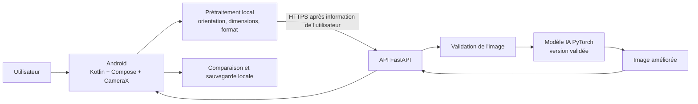
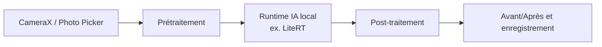
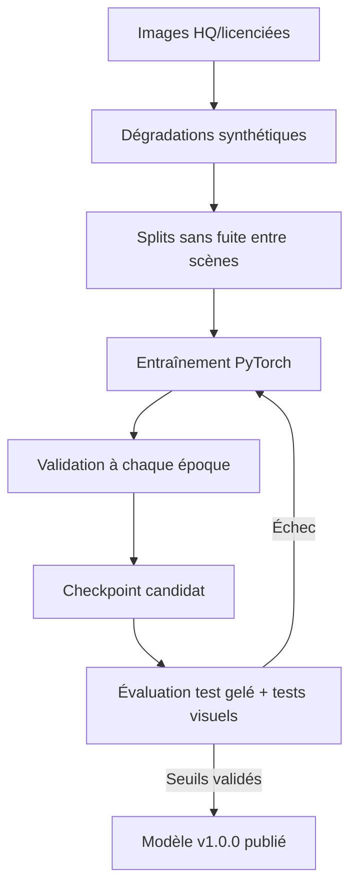

# AyyPhoto — AI Smart Camera

> **Documentation fonctionnelle et technique du projet**  
> **Version du document :** 1.0  
> **Date :** 18 octobre 2026  
> **Statut :** proposition d'architecture et feuille de route — développement non commencé  
> **Plateforme cible :** Android  
> **Langue :** français

---

## Table des matières

1. [Résumé exécutif](#1-résumé-exécutif)
2. [Problème, vision et proposition de valeur](#2-problème-vision-et-proposition-de-valeur)
3. [Utilisateurs et scénarios d'utilisation](#3-utilisateurs-et-scénarios-dutilisation)
4. [Périmètre fonctionnel : MVP et évolutions](#4-périmètre-fonctionnel--mvp-et-évolutions)
5. [Exigences fonctionnelles et non fonctionnelles](#5-exigences-fonctionnelles-et-non-fonctionnelles)
6. [Architecture technique](#6-architecture-technique)
7. [Stratégie de modèles IA](#7-stratégie-de-modèles-ia)
8. [Données : collecte, préparation et qualité](#8-données--collecte-préparation-et-qualité)
9. [Entraînement initial du modèle](#9-entraînement-initial-du-modèle)
10. [Réentraînement, apprentissage continu et versionnage](#10-réentraînement-apprentissage-continu-et-versionnage)
11. [Évaluation, validation et critères de publication](#11-évaluation-validation-et-critères-de-publication)
12. [Application Android : conception](#12-application-android--conception)
13. [API backend : contrat proposé](#13-api-backend--contrat-proposé)
14. [Déploiement sur Android : cloud puis hors ligne](#14-déploiement-sur-android--cloud-puis-hors-ligne)
15. [Sécurité, confidentialité et cadre juridique](#15-sécurité-confidentialité-et-cadre-juridique)
16. [Observabilité, exploitation et maintenance](#16-observabilité-exploitation-et-maintenance)
17. [Tests et assurance qualité](#17-tests-et-assurance-qualité)
18. [Structure du dépôt Git](#18-structure-du-dépôt-git)
19. [Environnement de développement et démarrage](#19-environnement-de-développement-et-démarrage)
20. [Feuille de route, charges et priorités](#20-feuille-de-route-charges-et-priorités)
21. [Risques et mesures d'atténuation](#21-risques-et-mesures-datténuation)
22. [Définition de terminé — MVP](#22-définition-de-terminé--mvp)
23. [Backlog initial et décisions à prendre](#23-backlog-initial-et-décisions-à-prendre)
24. [Glossaire](#24-glossaire)
25. [Sources et documentation officielle](#25-sources-et-documentation-officielle)

---

## 1. Résumé exécutif

**AyyPhoto** est une application Android de prise de photo et d'amélioration automatique d'images par intelligence artificielle. Elle vise en priorité les utilisateurs de smartphones dotés d'un appareil photo limité (bruit élevé, manque de lumière, faible niveau de détail, compression excessive).

**Expérience cible :** l'utilisateur ouvre AyyPhoto, prend une photo, l'application l'analyse et propose rapidement une version améliorée, avec comparaison avant/après et sauvegarde.

**Approche de réalisation recommandée :**

1. Construire un **MVP** qui traite les images **après** la capture, plutôt que de promettre de la vidéo corrigée en temps réel.
2. Commencer par une tâche IA mesurable : **réduction du bruit** sur photos de smartphone ; ajouter ensuite amélioration de la luminosité et super-résolution.
3. Entraîner ou adapter le modèle en **Python/PyTorch**, puis le servir via une **API FastAPI** pendant les premières expérimentations.
4. Garder chaque version du modèle et son jeu d'évaluation pour pouvoir effectuer du **fine-tuning**, comparer les résultats et revenir en arrière.
5. Étudier plus tard l'inférence **sur l'appareil** avec **LiteRT** ou un autre moteur compatible si la conversion, la mémoire et la latence sont satisfaisantes.

> **Précision technique importante :** une IA peut améliorer la perception d'une image, mais **ne peut pas garantir la récupération fidèle d'informations jamais capturées** par le capteur. Elle peut inventer des textures ou des détails (par exemple du texte ou des traits de visage). AyyPhoto doit préserver l'original et éviter de présenter le résultat comme une preuve photographique exacte.

## 2. Problème, vision et proposition de valeur

### 2.1 Problématique

De nombreuses personnes prennent des photos avec des téléphones d'entrée ou de milieu de gamme. Elles rencontrent régulièrement :

- du **bruit numérique**, surtout en faible luminosité ;
- du **flou** dû au mouvement ou à une mise au point imparfaite ;
- des zones **trop sombres ou surexposées** ;
- un manque de détails fins et une **compression JPEG** visible ;
- des couleurs peu naturelles.

### 2.2 Vision

> « Prendre de meilleures photos avec le téléphone que l'on possède déjà. »

### 2.3 Objectifs produit

- Simplifier le processus : capture → amélioration → comparaison → sauvegarde.
- Réduire le bruit et améliorer la qualité perçue sans réglages complexes.
- Permettre à l'utilisateur de conserver **l'original** et de choisir le résultat.
- Concevoir une IA améliorable au fil du temps par nouvelles campagnes d'entraînement.
- Protéger les photos privées et éviter toute collecte implicite pour l'entraînement.

### 2.4 Indicateurs de réussite (KPI)

Les seuils ci-dessous sont des **objectifs initiaux à valider**, pas des résultats déjà obtenus :

| Indicateur | Cible exploratoire MVP | Comment mesurer |
|---|---|---|
| Parcours principal terminé | ≥ 90 % des tests internes | Capture → résultat → sauvegarde |
| Taux d'échec du traitement | < 2 % en environnement de test | Logs techniques agrégés |
| Temps de traitement perçu | Cible de départ : < 5 s sur les photos/tests de référence | P50 / P95, réseau inclus en mode cloud |
| Préférence humaine pour l'image améliorée | > 60 % sur un protocole aveugle | Évaluateurs, scènes diverses |
| Régression sur les anciennes photos | Aucune régression importante selon les seuils validés | Jeu de test gelé |
| Préservation des détails sensibles | Aucun défaut grave accepté en test ciblé | Visages, écriture, documents |

Ces seuils seront ajustés après les premiers benchmarks sur de vrais téléphones.

## 3. Utilisateurs et scénarios d'utilisation

**Personas prioritaires :**

1. **Utilisateur quotidien** : souhaite prendre de meilleures photos sans apprendre la retouche.
2. **Utilisateur d'un téléphone économique** : rencontre beaucoup de bruit et de manque de lumière.
3. **Créateur de contenu débutant** : souhaite publier une photo plus nette sans outil compliqué.

**Scénario principal :**

1. L'utilisateur ouvre la caméra d'AyyPhoto.
2. Il accorde la permission caméra si nécessaire.
3. Il prend une photo ; l'original est conservé temporairement.
4. Il déclenche ou confirme le traitement IA.
5. L'application présente un état de chargement, puis le résultat.
6. Il peut déplacer un séparateur **Avant / Après**.
7. Il enregistre la photo améliorée, garde l'original ou recommence.

**Scénarios secondaires :** import d'une photo existante ; refus d'accès réseau ; photo très volumineuse ; traitement échoué ; espace disque insuffisant ; autorisation caméra refusée.

## 4. Périmètre fonctionnel : MVP et évolutions

### 4.1 MVP — version 1.0.0

| Fonctionnalité | Priorité | Notes |
|---|---|---|
| Capture photo avec CameraX | Obligatoire | Mise au point/exposition natives |
| Import depuis galerie | Obligatoire | Android Photo Picker recommandé |
| Amélioration automatique **après** capture | Obligatoire | Première version : débruitage |
| Comparateur avant/après | Obligatoire | Slider ou bascule |
| Sauvegarde locale de la version améliorée | Obligatoire | Sans effacer l'original |
| Indicateur de chargement, erreur, relance | Obligatoire | Pas d'interface bloquée |
| Information claire si transfert vers serveur | Obligatoire pour le cloud | Affichage avant envoi |
| Gestion des erreurs réseau | Obligatoire pour le cloud | Timeout, offline, retry |
| Authentification utilisateur | Non requise | Éviter la complexité initiale |
| Vidéo temps réel | Hors périmètre | Très coûteux |
| Retouche créative/générative | Hors périmètre | Risque d'invention de contenu |

### 4.2 Évolutions possibles

- **v1.1.x :** meilleur débruitage grâce à davantage de photos réelles.
- **v1.2.x :** correction de faible luminosité ; contrôle de l'intensité.
- **v1.3.x :** super-résolution optionnelle, traitement par lots limité.
- **v2.x :** traitement local/offline ; conseils de cadrage et stabilité avant capture.
- **Plus tard :** prise en charge RAW/DNG, plusieurs prises combinées, optimisation spécifique par modèle de smartphone.

**À ne pas promettre dans le MVP :** « qualité reflex », « restauration parfaite », « traitement instantané sur tous les Android », « préservation garantie de chaque détail ».

## 5. Exigences fonctionnelles et non fonctionnelles

### 5.1 Exigences fonctionnelles

- **FR-01** : prendre une photo depuis l'application.
- **FR-02** : importer une image que l'utilisateur a explicitement sélectionnée.
- **FR-03** : exécuter un traitement IA selon le mode configuré.
- **FR-04** : afficher l'état `chargement / succès / échec`.
- **FR-05** : comparer original et résultat.
- **FR-06** : exporter l'image sans remplacer automatiquement l'original.
- **FR-07** : connaître la version du modèle qui a produit le résultat (journal technique local ou métadonnée optionnelle).
- **FR-08** : pouvoir désactiver tout partage de données d'amélioration de l'IA ; la participation est facultative et distincte du traitement normal.

### 5.2 Exigences non fonctionnelles

- **Performance :** mesurer P50/P95 du prétraitement, réseau, inférence et sauvegarde, sur CPU serveur et téléphones réels.
- **Compatibilité :** fixer `minSdk`, `targetSdk`, architectures CPU et formats d'image selon les appareils testés ; réviser les exigences Google Play à la publication.
- **Résilience :** afficher des messages compréhensibles en cas de timeout, faible mémoire ou perte de connexion.
- **Qualité :** éviter les artefacts excessifs, les visages artificiels et les changements de couleur injustifiés.
- **Confidentialité :** minimisation des données, suppression des caches et conservation limitée.
- **Accessibilité :** boutons lisibles, contrastes adaptés, libellés pour les lecteurs d'écran.
- **Maintenabilité :** code séparé Android / API / ML ; tests reproductibles ; versions figées.

## 6. Architecture technique

### 6.1 Architecture MVP : traitement cloud (proposée)



**Pourquoi le cloud au début ?** Il permet de tester des modèles PyTorch sans convertir immédiatement toute l'architecture IA en modèle Android. **Inconvénients :** coût du serveur, nécessité d'une connexion, temps de transfert et enjeux de confidentialité. Une alternative locale est préférable à terme si elle est techniquement faisable.

### 6.2 Architecture cible : traitement sur téléphone



**Attention :** un fichier PyTorch `.pth` ne fonctionne **pas directement** dans LiteRT. Il faudra une **conversion/compilation compatible**, vérifier les opérations du réseau, comparer les sorties numériques et mesurer la mémoire et la vitesse sur des appareils représentatifs. Si un modèle est trop lourd, prévoir une architecture mobile plus petite ou un modèle distillé.

### 6.3 Technologies recommandées

| Couche | Choix | Rôle |
|---|---|---|
| Interface Android | Kotlin + Jetpack Compose | UI moderne |
| Photo | CameraX | Aperçu et capture |
| Import | Android Photo Picker | Sélection explicite |
| Architecture Android | MVVM + Repository | Séparation UI / logique |
| Réseau Android | Retrofit/OkHttp | Requêtes HTTP |
| Entraînement | Python + PyTorch | ML et fine-tuning |
| Manipulation des images | Pillow, OpenCV, NumPy | Décodage et dégradations |
| API | FastAPI + Uvicorn | Service d'inférence |
| Suivi expérimental | Fichiers JSON/CSV, puis MLflow si besoin | Métriques et modèles |
| Versionnage des données | Manifestes + DVC si nécessaire | Reproductibilité |
| Tests ML | pytest et benchmark scripts | Non-régression |
| Traitement local futur | LiteRT (sous réserve de compatibilité) | Inférence Android |

## 7. Stratégie de modèles IA

### 7.1 Définition du problème

Le modèle reçoit une image **dégradée** `x` et prédit une image restaurée `fθ(x)` qui se rapproche d'une image de référence `y` :

```text
Entrée : photo LQ (low quality) : RGB, dimensions variables
Modèle : f_theta(LQ)
Sortie : photo restaurée (même taille pour le débruitage MVP)
Référence d'entraînement : photo HQ (high quality) alignée
```

Pour la première version, travailler à **résolution constante** et avec un modèle de débruitage ; la super-résolution x2/x4 doit être une tâche séparée ou explicitement configurée.

### 7.2 Baselines avant modèle maison

Comparer d'abord :

1. **Aucun traitement** : image originale, référence minimale.
2. **Méthode traditionnelle** : débruitage OpenCV / ajustements simples.
3. **Petit CNN ou U-Net** : bon premier modèle entraînable et potentiellement exportable.
4. **Modèle pré-entraîné spécialisé** : Restormer pour certains scénarios de restauration ; Real-ESRGAN surtout pour la super-résolution/restauration générale.

Le **meilleur modèle** n'est pas forcément celui qui donne le meilleur rendu sur ordinateur : les coûts mémoire et temps de calcul comptent sur Android.

### 7.3 Recommandation

- **Phase recherche :** évaluer un petit U-Net/CNN de débruitage, plus un modèle pré-entraîné comme benchmark.
- **Phase qualité :** affiner le meilleur candidat sur un mélange de données synthétiques et de photos réelles.
- **Phase mobile :** distillation, quantification ou architecture légère après benchmarks de compatibilité.

## 8. Données : collecte, préparation et qualité

### 8.1 Types de données

**A. Données synthétiques (départ recommandé)** : à partir d'une bonne image, générer une version dégradée en simulant un ou plusieurs défauts : bruit (gaussien/poisson selon pipeline), flou, sous-exposition, compression JPEG, rééchantillonnage. La bonne image devient la cible supervisée.

**B. Données réelles appariées** : photographie de la même scène en mauvaise et meilleure qualité, avec pose/cadrage/exposition maîtrisés et **alignement**. Ces paires sont plus réalistes, mais difficiles à produire.

**C. Images d'utilisateurs volontaires** : uniquement avec un consentement **spécifique** à l'usage d'amélioration du modèle ; définir les droits, la durée de conservation et la suppression. Une photo notée « mauvaise » n'est pas automatiquement une cible HQ.

### 8.2 Format des paires

```text
datasets/
  raw/                         # source non modifiée, accès restreint
  processed/
    v1/
      train/
        lq/000001.png
        hq/000001.png
        lq/000002.png
        hq/000002.png
      val/
        lq/...
        hq/...
      test_old/
        lq/...
        hq/...
  manifests/
    dataset_v1.csv
    dataset_v2.csv
```

**Important :** `lq/000001.png` et `hq/000001.png` doivent représenter **la même scène alignée**. Sinon le modèle risque d'apprendre de mauvaises correspondances.

### 8.3 Champs suggérés pour le manifeste

```csv
pair_id,lq_path,hq_path,split,device,scene,condition,source,consent_reference
000001,train/lq/000001.png,train/hq/000001.png,train,phone_A,street,night,synthetic,not_applicable
```

Ajouter selon les besoins : niveau de bruit, résolution, hash SHA-256, licence, campagne de collecte et date de suppression prévue. Éviter les identifiants personnels dans les fichiers de données ML.

### 8.4 Règles de qualité des données

- Séparer **train / validation / test** par scène, session et si possible par appareil, pas simplement par fichiers : éviter que presque la même photo apparaisse dans deux ensembles.
- Supprimer les doublons ou quasi-doublons entre splits.
- Vérifier la résolution, l'orientation EXIF, les profils de couleur, les canaux RGB, le pixel range et l'alignement.
- Vérifier l'origine, la licence et le droit d'utiliser les images.
- Supprimer les métadonnées sensibles inutiles, notamment coordonnées GPS, avant tout envoi ou publication.
- Garder un **jeu de test gelé**, indépendant des décisions de fine-tuning.
- Inclure différentes scènes : portraits, nuit, intérieur, extérieur, texte, plantes, peaux diverses, plusieurs smartphones.

### 8.5 Volume de données

Il n'existe **pas de minimum universel**. Quelques centaines de paires peuvent suffire pour valider le pipeline ; la généralisation à de nombreuses caméras nécessite habituellement plus de diversité et des expériences. Mesurer la courbe de performance en fonction de la quantité de données avant de fixer un objectif définitif.

## 9. Entraînement initial du modèle

### 9.1 Pipeline proposé



### 9.2 Paramètres de départ (exemples, à mesurer)

| Paramètre | Point de départ exploratoire |
|---|---|
| Taille de patch | 128×128 ou 256×256 |
| Batch size | 4 à 16 selon VRAM |
| Optimiseur | AdamW |
| Taux d'apprentissage | 1e-4 pour un petit modèle entraîné de zéro ; plus faible en fine-tuning |
| Fonction de perte | L1 ; comparer à Charbonnier/SSIM/perceptual selon la tâche |
| Validation | À chaque époque ou intervalle fixe |
| Sélection finale | Meilleure validation puis validation sur test gelé |
| Reproductibilité | Seed + configuration + version du code + manifestes |

Ces valeurs sont **indicatives**. Elles dépendent de l'architecture, des poids pré-entraînés et du matériel.

### 9.3 Bonnes pratiques

- Initialiser les seeds Python, NumPy et PyTorch et **documenter** les sources éventuelles de non-déterminisme GPU.
- Utiliser une validation indépendante du train.
- Appliquer du *data augmentation* cohérent aux deux images d'une paire (même rotation/recadrage).
- Journaliser `train_loss`, `val_loss`, PSNR, SSIM, durée, mémoire GPU et exemples visuels.
- Sauvegarder `best` et `last` ; activer l'arrêt anticipé si nécessaire.
- Ne jamais comparer deux modèles en changeant simultanément la définition du test.

### 9.4 Exemple de checkpoint PyTorch

> Fragment à intégrer après définition de `model`, `optimizer`, `scheduler` et des variables d'entraînement. Ce n'est pas un script autonome.

```python
import torch

# Checkpoint de reprise EXACTE (poids + état d'entraînement).
checkpoint = {
    "epoch": epoch,
    "model_state_dict": model.state_dict(),
    "optimizer_state_dict": optimizer.state_dict(),
    "scheduler_state_dict": scheduler.state_dict(),
    "best_val_psnr": best_val_psnr,
    "model_version": "1.0.0",
    "dataset_version": "dataset_v1",
    "config": config,  # dictionnaire simple de configuration
}
torch.save(checkpoint, "artifacts/ayyphoto_v1.0.0_last.ckpt")

# Poids seuls pour l'inférence ou un futur fine-tuning :
torch.save(model.state_dict(), "artifacts/ayyphoto_v1.0.0.pth")
```

Pour reprendre **une session interrompue**, restaurer aussi l'optimiseur/scheduler et, pour une reproductibilité plus stricte, les états RNG et celui du sampler. Pour démarrer une **nouvelle version**, il est possible de recharger seulement les poids et de créer un optimiseur neuf avec un LR plus faible.

## 10. Réentraînement, apprentissage continu et versionnage

### 10.1 Oui : AyyPhoto peut être entraîné plusieurs fois

Exemple du cycle de vie :

```text
Dataset D1 ── entraînement ──> AyyPhoto Model 1.0.0
                                     │
Nouvelle collecte D2                 │ charger les poids
          │                          ▼
          └── + échantillons de D1 ──> fine-tuning ──> candidat 1.1.0
                                                       │
                                         tests anciens + nouveaux
                                                       │
                                 ┌─────────────────────┴────────────────┐
                                 ▼                                      ▼
                            amélioration                           régression
                                 │                                      │
                            publier 1.1.0                       garder 1.0.0
```

### 10.2 Le risque : *catastrophic forgetting*

Si `1.0.0` a été entraîné sur des photos nocturnes et que l'on affine le modèle **seulement** sur des portraits en extérieur, ses performances de nuit peuvent diminuer. Continuer l'entraînement ne garantit **pas** de préserver toutes les anciennes compétences.

### 10.3 Stratégie recommandée : replay + tests de non-régression

1. Conserver le **checkpoint publié 1.0.0**, non modifiable.
2. Collecter `D2` et vérifier consentements, licences, déduplication et annotations.
3. Constituer un mélange **D2 + échantillon représentatif de D1**. Si possible, tester plusieurs proportions d'anciens/nouveaux exemples.
4. Charger les poids de `1.0.0`, réinitialiser ou ajuster l'optimiseur et baisser le LR.
5. Affiner avec validation sur **anciens** et **nouveaux** scénarios.
6. Mesurer les gains **et** les régressions, notamment sur portraits, nuit, texte et différents téléphones.
7. Publier `1.1.0` **uniquement** si les critères de sortie sont respectés.
8. Garder un mécanisme de retour à `1.0.0` côté API (et côté Android si mise à jour locale).

**Si le replay ne suffit pas :** explorer une perte de distillation qui pousse le nouveau modèle à rester proche du précédent sur certains exemples ; éventuellement EWC ou autres méthodes d'apprentissage continu après mise en place de benchmarks fiables. Aucune méthode ne garantit zéro perte dans tous les cas.

### 10.4 Exemple conceptuel de fine-tuning

```python
import torch

# Hypothèse : l'architecture du modèle est inchangée.
model = AyyPhotoNet()  # classe définie dans le code du projet
weights = torch.load(
    "artifacts/ayyphoto_v1.0.0.pth",
    map_location="cpu",
    weights_only=True,
)
model.load_state_dict(weights)

optimizer = torch.optim.AdamW(model.parameters(), lr=1e-5)

# training_loader mélange anciennes et nouvelles paires (LQ, HQ).
# Le détail des boucles d'entraînement est à implémenter.
for lq, hq in training_loader:
    optimizer.zero_grad()
    prediction = model(lq)
    loss = torch.nn.functional.l1_loss(prediction, hq)
    loss.backward()
    optimizer.step()

# Ne pas écraser le modèle déployé : sauvegarder un candidat.
torch.save(model.state_dict(), "artifacts/ayyphoto_v1.1.0_candidate.pth")
```

**À adapter :** `AyyPhotoNet` et `training_loader` sont des composants du projet ; le traitement des dispositifs CPU/GPU, les époques et la validation doivent être ajoutés. Pour la comparaison, garder le même prétraitement et les mêmes tests.

### 10.5 Convention de versions

Distinguer trois versions :

- **Application Android** : `app_version = 1.0.0`.
- **Modèle** : `model_version = 1.1.0`.
- **Dataset** : `dataset_version = 2026-10-v2`.

Convention interne **inspirée de SemVer** pour les modèles :

- **PATCH** (`1.0.1`) : correction mineure et compatible, sans changement de contrat d'entrée/sortie.
- **MINOR** (`1.1.0`) : nouveau modèle apportant des améliorations tout en gardant l'API de pré/post-traitement compatible.
- **MAJOR** (`2.0.0`) : changement incompatible (résolution, format, normalisation, comportement de l'API, etc.).

Cette convention est un **choix du projet**, pas une norme obligatoire du versionnage ML.

### 10.6 Registre de modèles

Chaque release devrait comporter :

```text
models/
  1.0.0/
    weights.pth
    train_checkpoint.ckpt
    config.yaml
    model_card.md
    evaluation.json
    dataset_manifest_sha256.txt
  1.1.0/
    weights.pth
    train_checkpoint.ckpt
    config.yaml
    model_card.md
    evaluation.json
    dataset_manifest_sha256.txt
```

Le `model_card.md` doit documenter : tâche, données autorisées, architecture, prétraitement, métriques par scénario, limitations, tests sur visages/texte, licence, appareils testés et responsable de validation.

### 10.7 Promotion et rollback

- Étiquettes : `candidate`, `validated`, `production`, `deprecated`.
- La production référence une **version immuable** ou un identifiant de modèle résolu vers un artefact précis.
- Déploiement progressif si nécessaire (interne → bêta → production).
- En cas de régression : repointer le serveur sur l'ancienne version et noter l'incident.
- Ne jamais remplacer le contenu de `1.0.0.pth` sous le même nom/version.

## 11. Évaluation, validation et critères de publication

### 11.1 Mesures objectives

| Métrique | Utilisation | Limite |
|---|---|---|
| **PSNR** (dB) | Fidélité à une image de référence | N'évalue pas toute la qualité visuelle |
| **SSIM** | Similarité structurelle | Nécessite référence alignée |
| **LPIPS** (optionnel) | Similarité perceptuelle | Peut diverger de la fidélité au contenu |
| **Latence** P50/P95 | Expérience réelle | Dépend matériel/réseau |
| **Mémoire pic** | Compatibilité mobile | À mesurer par appareil |
| **Évaluation humaine** | Préférence, rendu naturel | Nécessite protocole cohérent |

Les PSNR/SSIM sont principalement utiles lorsque l'on dispose de **paires LQ/HQ alignées**. Pour des photos réelles sans cible, utiliser un protocole humain et des mesures sans référence avec prudence.

### 11.2 Banc de test gelé

Créer au minimum les groupes :

- `old_noise_day`, `old_noise_night` ;
- `new_device`, `new_scene` ;
- `portraits`, `text_documents`, `buildings`, `plants` ;
- `extreme_dark`, `motion_blur`, `jpeg_artifacts`.

Comparer toutes les versions sur **les mêmes fichiers** avec exactement les mêmes étapes de préparation. Segmenter les résultats par téléphone et condition plutôt que regarder seulement la moyenne globale.

### 11.3 Règle de promotion (exemple à décider)

Accepter un candidat seulement si :

1. il augmente la qualité sur les nouvelles données ou démontre un avantage produit ;
2. sa dégradation de PSNR/SSIM sur les anciens tests reste **en dessous des seuils décidés avant l'expérience** ;
3. aucun défaut critique n'est relevé sur visages, texte ou scènes sensibles ;
4. ses temps de traitement et son empreinte mémoire respectent les budgets du produit ;
5. le checkpoint, les configurations, les données de test et le rapport sont archivés.

Exemple fictif de tableau (ne représente **aucune mesure réelle**) :

| Suite de tests | Modèle v1.0.0 | Candidat v1.1.0 | Interprétation |
|---|---:|---:|---|
| Anciennes scènes (PSNR) | 29,8 dB | 29,9 dB | Stable |
| Nouvelles scènes (PSNR) | 25,1 dB | 28,4 dB | Amélioration |
| Latence moyenne | 1,2 s | 1,3 s | À confronter au budget |

## 12. Application Android : conception

### 12.1 Écrans du MVP

1. **Accueil / Caméra** : aperçu, bouton photo, accès galerie, information réseau.
2. **Traitement** : miniature, progression non trompeuse, annuler/réessayer.
3. **Résultat** : curseur avant/après, enregistrer, partager (optionnel), reprendre.
4. **Paramètres / Confidentialité** : mode de traitement, politique de confidentialité, choix explicite de contribution aux données, effacement cache local.

### 12.2 Architecture Android suggérée

```text
UI (Compose)
  └── ViewModel
      └── ImageRepository
          ├── CameraDataSource (CameraX)
          ├── GalleryDataSource (Photo Picker)
          ├── RemoteEnhancementDataSource (API)
          ├── LocalEnhancementDataSource (future)
          └── ImageStorageDataSource (MediaStore)
```

### 12.3 Éléments à traiter soigneusement

- Permissions caméra accordées au moment du besoin ; écran de repli si refus.
- Préserver le bon sens de l'image via l'orientation EXIF.
- Lire les URI via les API Android, sans supposer de chemins de fichiers réels.
- Respecter la mémoire : échantillonnage/découpage en tuiles pour photos très grandes.
- Ne pas effectuer d'I/O ni d'inférence longue sur le thread principal.
- Sauvegarder via les mécanismes Android adaptés (`MediaStore`/stockage spécifique).
- Ne pas écraser la source ; nommer la sortie, par exemple `AyyPhoto_20261018_140000.jpg`.
- Prévoir les formats JPEG et PNG au début ; tester HEIC selon prise en charge et stratégie de conversion.

## 13. API backend : contrat proposé

> **Il s'agit d'une spécification cible, pas d'une API déjà développée.**

### 13.1 Endpoints MVP

| Méthode | Route | Rôle |
|---|---|---|
| `GET` | `/health` | État du service |
| `GET` | `/v1/model-info` | Version du modèle en service et limites |
| `POST` | `/v1/enhance` | Envoi d'image et retour de l'image traitée |

### 13.2 Exemple de requête

```http
POST /v1/enhance HTTP/1.1
Host: api.example.com
Content-Type: multipart/form-data; boundary=...
Authorization: Bearer <jeton_de_test>

file = <fichier image>
mode = denoise
```

**Réponse proposée :** `200 OK` avec `Content-Type: image/jpeg` et en-tête `X-AyyPhoto-Model-Version: 1.0.0`.

```bash
# Exemple d'appel après déploiement d'une API réelle :
curl -X POST "https://api.example.com/v1/enhance" \
  -H "Authorization: Bearer $AYYPHOTO_API_TOKEN" \
  -F "file=@photo.jpg" \
  -F "mode=denoise" \
  --output photo_amelioree.jpg
```

`api.example.com` et le jeton sont des **placeholders**, non un service existant. Ne jamais embarquer de secret serveur durable dans une application Android.

### 13.3 Règles backend

- Accepter uniquement des formats image autorisés ; contrôler le **contenu décodé**, et pas uniquement l'extension/MIME.
- Définir une limite initiale de taille (ex. **15 Mo**, à ajuster après tests) et de dimensions/pixels ; refuser les images décompressées excessives.
- Autoriser `mode=denoise` dans le MVP ; refuser les modes inconnus.
- Appliquer limites de trafic, délais d'exécution, contrôle d'abus et authentification appropriée au contexte.
- Utiliser HTTPS, secrets dans les variables d'environnement/gestionnaire de secrets.
- Ne jamais tracer les octets des photos dans les logs.
- Supprimer rapidement les fichiers temporaires de traitement, même si une erreur survient.
- Rejeter proprement `400` (paramètres), `401/403` (accès), `413` (taille), `415` (format), `429` (quota), `500/503` (serveur).
- En charge significative, envisager file de traitement et jobs asynchrones **dans l'architecture du produit** (distinct de cette documentation).

## 14. Déploiement sur Android : cloud puis hors ligne

### 14.1 MVP cloud

1. Entraîner un modèle PyTorch sur ordinateur/GPU.
2. Geler la version validée du modèle.
3. Héberger l'inférence dans un service FastAPI.
4. Dans Android, envoyer l'image via HTTPS **après information claire** de l'utilisateur.
5. Récupérer le résultat et le sauvegarder localement.

### 14.2 Version locale

1. Choisir un réseau compatible avec un format/runtime mobile.
2. Convertir ou réentraîner/distiller si nécessaire.
3. Valider les **mêmes entrées et sorties** sur Python et sur Android.
4. Tester CPU/GPU/NPU lorsque disponibles, y compris sur téléphones modestes.
5. Mesurer modèle compressé, consommation de RAM, batterie, latence et température.
6. Définir un *fallback* (prétraitement classique, mode cloud opt-in, ou photo d'origine).

**Point de vigilance :** LiteRT est un runtime d'inférence, pas un moyen automatique de charger n'importe quel `.pth`. La compatibilité de l'architecture IA doit être vérifiée expérimentalement.

## 15. Sécurité, confidentialité et cadre juridique

### 15.1 Principes

- **Photos privées par défaut** : pas d'upload hors du traitement demandé.
- **Finalités séparées** : traiter une photo pour l'utilisateur n'autorise **pas** automatiquement son utilisation pour entraîner un modèle.
- **Consentement distinct et révocable** pour donner des images à la collecte destinée à l'IA, avec information sur ce qui sera gardé.
- **Minimisation** : ne pas demander accès à toute la galerie si l'utilisateur n'a sélectionné qu'une photo ; utiliser Android Photo Picker pour l'import.
- **Rétention limitée** : documenter durée de conservation des uploads, logs techniques et éventuels jeux de données autorisés.
- **Droits utilisateur** : fournir procédure de demande d'accès, de suppression ou de retrait, selon le cadre juridique applicable.
- **Transparence** : préciser si l'image est traitée sur téléphone ou sur serveur et si un transfert transfrontalier a lieu.

### 15.2 Risques particuliers

- Photos de visages, documents, enfants, lieux privés ou informations de localisation.
- Métadonnées EXIF contenant notamment des coordonnées GPS.
- Artefacts artificiels sur écriture, identité, plaques ou détails importants.
- Accès serveur non protégé et fuites accidentelles de fichiers temporaires.
- Jeux de données tiers sans licence adéquate.

### 15.3 Obligations à vérifier avant publication

- **Google Play** : politique de confidentialité accessible, déclaration **Data safety** exacte, gestion conforme des permissions et des données.
- **Maroc (si applicable)** : examiner la **loi 09-08** et les démarches éventuelles auprès de la **CNDP** selon la nature des traitements, l'hébergement et les transferts.
- **Autres territoires** : évaluer les obligations applicables (par exemple RGPD si AyyPhoto cible des utilisateurs concernés dans l'UE).
- Respect des licences du **code**, des **poids pré-entraînés** et des **datasets**, dont les conditions peuvent différer.

> Cette rubrique indique des vérifications nécessaires et **ne remplace pas un avis juridique**.

## 16. Observabilité, exploitation et maintenance

- **Mesures techniques** : nombre de traitements, latence P50/P95, taux d'erreur, taille des images, version du modèle, consommation GPU/CPU.
- **Sans exposer de photos** : ne pas enregistrer d'images ou de données identifiantes dans les journaux de performance.
- **Suivi des coûts** : prix par image, transferts réseau, serveur GPU, espace de stockage, volume de requêtes.
- **Alertes** : erreurs `5xx`, latence excessive, saturations et quota.
- **Maintenance modèle** : revue périodique des images anonymisées/autorisées et des feedbacks, *drift* de nouvelles caméras, campagnes de validation.
- **Mises à jour** : documentation des changements, benchmark avant déploiement, rollback testé.

## 17. Tests et assurance qualité

### 17.1 Tests IA

- Paires synthétiques : bruit léger, moyen, fort.
- Vraies photos : jour/nuit, intérieur/extérieur, portraits, textes.
- Compatibilité forme/format : JPEG/PNG, orientation, canaux RGB, dimensions impaires.
- Détection d'artefacts, de sur-lissage et de changement de couleurs.
- Non-régression entre versions sur un jeu gelé.

### 17.2 Tests API

- Image valide → image retournée.
- Mauvaise extension / faux type / fichier corrompu → erreur contrôlée.
- Très grand fichier / nombre excessif de pixels → rejet sans crash.
- Timeout, requêtes concurrentes, authentification et quotas.
- Nettoyage des fichiers temporaires après succès **et** erreur.

### 17.3 Tests Android

- Permission caméra refusée ou accordée.
- Appareil sans réseau pendant un traitement cloud.
- Rotation de l'écran, mise en arrière-plan, interruption d'appel.
- Faible stockage / faible mémoire / basse batterie.
- Capture et import de photos de tailles différentes.
- Exactitude avant/après et original non écrasé.
- Tests sur **au moins un smartphone peu puissant et un smartphone plus performant** ; élargir ensuite la matrice.

### 17.4 Tests utilisateurs

Conduire des sessions courtes : l'utilisateur comprend-il quand une image part sur le serveur ? Voit-il le progrès ? Comprend-il la différence entre original et résultat ? Peut-il retrouver le fichier sauvegardé ?

## 18. Structure du dépôt Git

```text
ayyphoto/
├── README.md                    # présent document
├── LICENSE                      # à choisir
├── .gitignore
├── docs/
│   ├── architecture.md
│   ├── privacy-policy.md
│   ├── api.md
│   └── model-cards/
├── android/
│   ├── app/
│   └── ...                      # projet Android Studio
├── backend/
│   ├── app/
│   │   ├── main.py
│   │   ├── routes/
│   │   ├── services/
│   │   └── schemas/
│   ├── tests/
│   ├── requirements.txt
│   └── Dockerfile
├── ml/
│   ├── configs/
│   ├── src/
│   │   ├── datasets.py
│   │   ├── models.py
│   │   ├── degradations.py
│   │   └── metrics.py
│   ├── scripts/
│   │   ├── train.py
│   │   ├── finetune.py
│   │   ├── evaluate.py
│   │   └── infer.py
│   ├── tests/
│   └── requirements.txt
├── data/
│   ├── README.md                # sources et règles ; pas les photos privées
│   └── manifests/
├── experiments/                 # journaux sans données sensibles
└── artifacts/                   # poids locaux, normalement hors Git
```

**Important :** ne pas envoyer sur Git des photos personnelles, tokens d'API, datasets soumis à restrictions, checkpoints lourds ou journaux privés. Utiliser `.gitignore` et, si nécessaire, du stockage versionné séparé (DVC, registre d'artefacts, dépôt de modèles approprié).

## 19. Environnement de développement et démarrage

### 19.1 Prérequis

- Android Studio et SDK Android récents, un appareil Android réel pour valider CameraX.
- Python compatible avec les versions choisies de PyTorch et dépendances.
- Git ; machine disposant idéalement d'un GPU pour l'entraînement, ou environnement GPU hébergé.
- Espace disque suffisant pour les images, modèles et résultats.

### 19.2 Configuration Python (squelette)

```bash
# Depuis la racine du dépôt AyyPhoto :
python -m venv .venv
source .venv/bin/activate   # Linux/macOS
# Sous Windows : .venv\Scripts\activate

# À créer : fichiers de dépendances épinglées et compatibles
pip install -r ml/requirements.txt

# Commandes futures (scripts à implémenter dans le projet)
python ml/scripts/train.py --config ml/configs/denoise_v1.yaml
python ml/scripts/evaluate.py --model artifacts/ayyphoto_v1.0.0.pth
python ml/scripts/finetune.py --config ml/configs/denoise_v1_1.yaml
```

Ces commandes décrivent **l'interface CLI à développer** ; le présent fichier ne contient pas encore les modules ni les fichiers `requirements.txt`.

### 19.3 Ordre conseillé d'implémentation

1. Collecter un premier ensemble de photos HQ librement utilisables.
2. Écrire le générateur de dégradations et vérifier visuellement les paires LQ/HQ.
3. Créer les splits et manifestes.
4. Construire un benchmark de base (original + débruitage traditionnel).
5. Entraîner un petit modèle PyTorch, l'évaluer et figer `1.0.0`.
6. Tester l'inférence en local sur PC avec de vraies photos.
7. Exposer l'inférence derrière une API FastAPI minimale.
8. Créer CameraX, l'import galerie et l'écran avant/après.
9. Intégrer Android ↔ API ; tester réseau, erreurs et confidentialité.
10. Préparer collecte volontaire, réentraînement `1.1.0`, validation et rollback.

## 20. Feuille de route, charges et priorités

> Estimation de **planification indicative** pour un développeur qui apprend une partie de la stack ; la durée réelle dépend de l'expérience, des données et du matériel.

| Étape | Livrable | Horizon indicatif |
|---|---|---|
| 1. Spécification | Objectifs, écrans, critères de réussite | Semaine 1 |
| 2. Données & baseline | Paires, splits, tests et pipeline de dégradation | Semaines 2–3 |
| 3. IA v1 | Premier modèle, métriques, sauvegarde du checkpoint | Semaines 3–5 |
| 4. API | Inférence et gestion des erreurs | Semaine 5 |
| 5. Android | Caméra, import, résultat, stockage | Semaines 5–7 |
| 6. Intégration & QA | Tests sur vrais appareils, correctifs | Semaines 7–8 |
| 7. v1.1 | Réentraînement, tests anciens/nouveaux | Après MVP |
| 8. Offline | Prototype de conversion et benchmarks mobiles | Après validation de l'intérêt |

### Budget : postes à prévoir

- GPU (local ou location ponctuelle) et durée des entraînements.
- Stockage des datasets / sauvegardes et accès réseau.
- Hébergement de l'API et capacité GPU/CPU pour les requêtes.
- Tests sur plusieurs téléphones de prix et générations différents.
- Éventuels coûts de publication, d'observabilité et de revue juridique.

**Aucun montant chiffré n'est fixé** avant la mesure du nombre d'images à traiter, du temps GPU par image et du volume d'utilisateurs.

## 21. Risques et mesures d'atténuation

| Risque | Conséquence | Atténuation |
|---|---|---|
| Données synthétiques trop éloignées du réel | Modèle peu efficace sur smartphones | Introduire tests et paires réelles |
| Fuite de données entre train et test | Scores artificiellement bons | Découper par scène/session/téléphone |
| Oubli catastrophique | v1.1 moins bonne sur les anciennes scènes | Replay, suites de non-régression, rollback |
| Hallucination de détails | Photo trompeuse / texte modifié | Préserver original, tests sensibles, modes prudents |
| Modèle trop lourd | Application lente, chauffe, crash | Baseline légère, quantification, découpage en tuiles |
| Coût serveur trop élevé | Modèle économique non viable | Budget par image, cache de ressources, option locale |
| Envoi de photos non consenti | Atteinte à la vie privée | Consentements séparés, transparence, minimisation |
| Incompatibilité runtime mobile | Impossible de lancer le modèle localement | Vérifier conversion tôt avec un modèle minimal |
| Dépendances/licences non conformes | Problème juridique | Inventaire des licences poids/code/données |

## 22. Définition de terminé — MVP

Le MVP **n'est considéré terminé** que lorsque :

- [ ] L'utilisateur peut ouvrir la caméra et prendre une photo.
- [ ] L'utilisateur peut sélectionner une photo depuis la galerie.
- [ ] L'application exécute le traitement prévu et affiche le résultat.
- [ ] L'original est conservé ; comparaison avant/après fonctionnelle.
- [ ] L'utilisateur peut enregistrer la photo améliorée.
- [ ] Les erreurs de réseau, d'image et de stockage sont correctement gérées.
- [ ] Le modèle `1.0.0` et son dataset de test sont archivés avec métriques.
- [ ] Les résultats sont comparés à l'original et à une baseline non-IA.
- [ ] Les permissions, flux de transfert, politique de confidentialité et conservation sont définis.
- [ ] Les tests passent sur les appareils Android de référence.
- [ ] Le coût et la latence par image sont mesurés.
- [ ] Un retour à la version précédente du modèle est possible.

## 23. Backlog initial et décisions à prendre

### À développer, par ordre de priorité

- [ ] Définir **une tâche prioritaire** pour la v1 : débruitage.
- [ ] Constituer des datasets autorisés et créer le manifeste.
- [ ] Écrire `degradations.py` et tests de paires.
- [ ] Écrire `models.py`, `train.py`, `evaluate.py`.
- [ ] Enregistrer des checkpoints complets et des poids d'inférence.
- [ ] Fixer seuils d'acceptation d'une version IA avant l'expérience.
- [ ] Écrire l'inférence serveur puis l'API.
- [ ] Créer l'app Android et relier le parcours utilisateur.
- [ ] Rédiger une politique de confidentialité exacte, adaptée aux flux réels.
- [ ] Déployer un environnement de test fermé.
- [ ] Mettre en place le protocole v1.0 → v1.1 (replay + tests anciens/nouveaux).

### Décisions ouvertes (à valider avant développement avancé)

| Sujet | Choix recommandé pour commencer | À trancher |
|---|---|---|
| Fonction IA v1 | Débruitage | Ou faible luminosité en premier ? |
| Calcul | API cloud MVP | Le cloud est-il acceptable pour les utilisateurs ? |
| Connexion | Aucune création de compte MVP | Authentification plus tard ? |
| Données utilisateur | Aucune réutilisation pour entraînement sans opt-in | Politique de rétention définitive |
| Appareils cibles | Petits et moyens smartphones | `minSdk` selon tests réels |
| Taille maximale | 15 Mo à titre de départ | Adapter selon mémoire et coûts |
| Licence AyyPhoto | À déterminer | Open source ou propriétaire ? |
| Fournisseur d'hébergement | À déterminer | Coût, sécurité, géographie |

## 24. Glossaire

- **LQ (Low Quality)** : image dégradée à améliorer.
- **HQ (High Quality)** : image de référence servant de cible d'entraînement.
- **Fine-tuning** : adaptation d'un modèle pré-entraîné sur un nouveau jeu de données.
- **Continual Learning** : apprentissage progressif dans le temps.
- **Experience Replay** : réintroduction d'anciennes données pendant les nouveaux entraînements.
- **Catastrophic Forgetting** : perte de capacités anciennes après adaptation à de nouvelles données.
- **Checkpoint** : sauvegarde des poids et éventuellement de l'optimiseur et des états d'entraînement.
- **Inference** : exécution d'un modèle pour produire une sortie, sans apprentissage.
- **PSNR / SSIM** : mesures de fidélité nécessitant généralement une référence alignée.
- **MVP** : première version fonctionnelle limitée aux besoins essentiels.
- **Rollback** : retour rapide à une version précédemment validée.
- **Model card** : fiche documentant la portée, les résultats et les limites du modèle.

## 25. Sources et documentation officielle

Références techniques et juridiques à consulter lors de l'implémentation :

- [Android Developers — CameraX : capture d'image](https://developer.android.com/media/camera/camerax/take-photo)
- [Android Developers — Photo Picker](https://developer.android.com/training/data-storage/shared/photo-picker)
- [Google AI Edge — LiteRT pour Android](https://developers.google.com/edge/litert/android)
- [PyTorch — Saving and Loading Models](https://docs.pytorch.org/tutorials/beginner/saving_loading_models.html)
- [Real-ESRGAN — code source](https://github.com/xinntao/Real-ESRGAN)
- [Real-ESRGAN — guide d'entraînement / fine-tuning](https://github.com/xinntao/Real-ESRGAN/blob/master/docs/Training.md)
- [Restormer — code et modèles](https://github.com/swz30/Restormer)
- [Google Play — règles sur les données et la confidentialité](https://support.google.com/googleplay/android-developer/answer/10144311)
- [CNDP Maroc — loi 09-08](https://www.cndp.ma/loi-09-08/)
- [FastAPI — documentation](https://fastapi.tiangolo.com/)

**Note sur les licences :** la licence du dépôt source, les poids pré-entraînés et les jeux de données doivent chacun être vérifiés avant une réutilisation ou une commercialisation. Ne pas présumer qu'ils ont tous la même licence.

---

## Conclusion

La stratégie la plus réaliste consiste à **livrer une caméra Android avec amélioration après capture**, à entraîner un **modèle de débruitage simple et évaluable**, puis à le réentraîner avec de nouvelles images **en conservant les anciennes données représentatives et les anciens checkpoints**. La version `1.1.0` n'est publiée qu'après comparaison rigoureuse avec `1.0.0` sur les **anciens et nouveaux** cas d'usage.

Le modèle peut évoluer continuellement, mais **aucune technique ne garantit une amélioration sans régression**. La stabilité repose sur la qualité des données, la validation et le droit de revenir à la version précédente.

**Statut du document :** cahier des charges et plan d'implémentation proposés. Les composants, chiffres de performance, endpoints et commandes de développement mentionnés comme *exemples* ne sont pas encore livrés ni mesurés.
